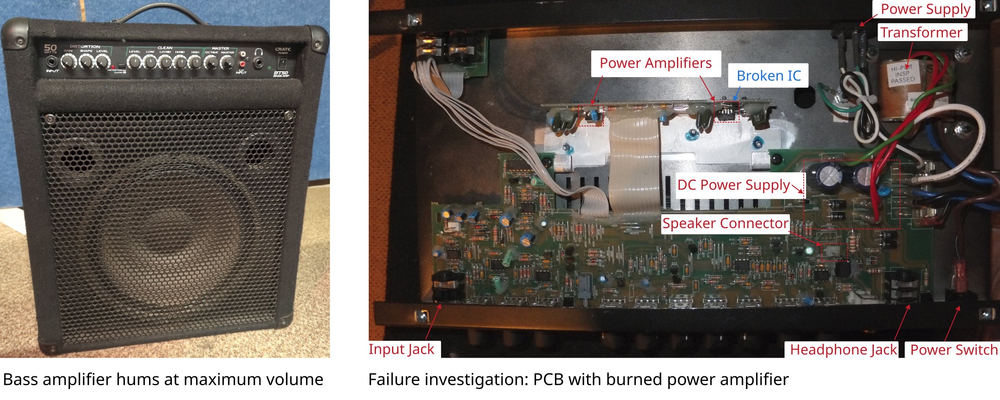

# Bass amplifier hums at maximum volume 

Manufacturer: `CRATE`     
Type: `BT50W`    

## Description of failure
When turned on, the amplifier immediately starts humming at full volume. 
Signals from the instrument are ignored.

## Failure investigation
First, check the power supply. It shows no abnormalities. 

Now check the following:
 - The signal path through the preamplifier. The best approach is to feed in a sine wave of a known frequency, trace the signal through the amplifier, and look for a component where the applied signal is present at the input but a low-frequency signal is measurable at the output.
 - If the signal can be traced all the way through (not entirely easy; a schematic from the Internet may be necessary), the component can be located fairly easily.
 - Without a schematic, it may not be so easy to trace the signal all the way through the amplifier.
 - In this case, it may be advisable to trace the signal path in reverse, starting from the speaker.
 - In this case, a 100 Hz signal with a DC offset is present at one of the two power amplifiers. However, the input is the signal being fed into the system. Consequently, the power amplifier has burned out, and the DC power supply—which is not perfectly smoothed (it has a 100 Hz ripple that does not interfere during normal operation)—is present at the speaker, resulting in the very loud humming noise.

Defective component: `ST TDA2050`, a 32 W hifi auto power amplifier

The defective component is replaced, and the amplifier works perfectly again.